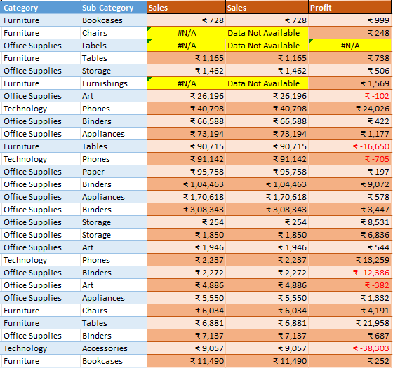
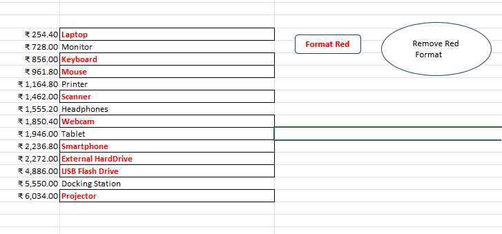

# Advanced Excel – Practical Assignments

## 1. Project Overview

This repository contains a collection of practical Microsoft Excel assignments completed to develop and demonstrate proficiency in Excel formulas, data manipulation, formatting, data analysis, reporting, and VBA macros.

The workbook contains **26 worksheets**, including 12 structured learning sections, an index, supporting datasets, and practice sheets.

The assignments focus on applying Excel functions to practical business scenarios, particularly sales data, product information, order records, and reporting.

## 2. Project Objectives

- Develop proficiency in Excel formulas and functions.
- Perform calculations and analyse sales data.
- Apply logical conditions and error-handling techniques.
- Clean and organise datasets.
- Retrieve information using lookup functions.
- Summarise data using Pivot Tables.
- Apply conditional formatting and custom number formats.
- Consolidate information across multiple worksheets.
- Understand and practise VBA macro automation.

## 3. Excel Skills Covered

| Section | Topics and Practical Exercises |
|---|---|
| 1 | Mathematical and statistical functions, SUM, MAX, MIN, SMALL, LARGE, MEDIAN, COUNT, COUNTA, COUNTBLANK, growth calculations and POWER |
| 2 | Cell formatting, currency and number formats, conditional formatting, alignment, Wrap Text and Merge & Center |
| 3 | Sorting numerical values and dates in ascending and descending order |
| 4 | Date calculations, timestamps, date differences and DATEDIF |
| 5 | Logical functions including IF, AND, OR and IFERROR |
| 6 | Identifying and removing duplicate records and error values |
| 7 | Working with sales datasets and applying analytical functions |
| 8 | VLOOKUP and retrieving information from structured datasets |
| 9 | COUNTIF, SUMIF and AVERAGEIF |
| 10 | Conditional formatting using rules, colour scales and data bars |
| 11 | Consolidating data from multiple worksheets using Excel's Consolidate feature |
| 12 | Introduction to VBA macros, macro recording, VBA concepts and automation |

## 4. Practical Excel Techniques

The assignments include hands-on exercises involving:

**Formulas and Functions**
- SUM, MAX, MIN, SMALL, LARGE and MEDIAN
- COUNT, COUNTA and COUNTBLANK
- IF, AND, OR and IFERROR
- VLOOKUP
- COUNTIF, SUMIF and AVERAGEIF
- Date and time calculations
- Growth percentage calculations

**Data Management**
- Sorting and organising data
- Removing duplicates
- Identifying and handling errors
- Consolidating data across worksheets

**Formatting and Reporting**
- Conditional formatting
- Custom number formats
- Currency and percentage formatting
- Data bars and colour scales
- Pivot Tables and summarisation

**Automation**
- Recording and understanding VBA macros
- Practical macro-based formatting and automation exercises

## 5. Practical Work – Screenshots

The following screenshots demonstrate selected exercises completed in the workbook.

### 1. Excel Functions and Calculations

Practical use of Excel formulas for calculations, numerical analysis and error handling.

### 2. Function-Based Columns

Creating calculated columns using formulas and applying IFERROR to handle exceptional values.

### 3. Lookup Functions

Applying lookup functions and logical conditions to retrieve and classify information across datasets.

### 4. Conditional Formatting

Using conditional formatting rules to highlight values based on defined criteria.

### 5. Pivot Table Analysis

Summarising and analysing data using Pivot Tables.

### 6. Multi-dimensional Pivot Tables

Analysing sales and profit across categories, customer segments, regions and time periods.

### 7. Number and Custom Formatting

Applying currency formats, percentage formats and custom number formats to improve data presentation.

### 8. VBA Macros

Demonstrating macro-based automation, including applying and removing formatting through interactive controls.

## 6. Tools Used

- Microsoft Excel
- Excel formulas and functions
- Pivot Tables
- Conditional Formatting
- VBA Macros

## 7. Project Files

| File | Description |
|---|---|
| `Prajot_Excel Module Assignment.xlsm` | Complete macro-enabled Excel workbook containing practical assignments, supporting datasets, calculations and exercises. |

## 8. Learning Outcomes

Through these assignments, I developed practical experience in:

- Applying Excel functions to business-oriented datasets.
- Building formula-based calculations and logical conditions.
- Retrieving and summarising information from multiple datasets.
- Cleaning and organising data.
- Presenting information using formatting and Pivot Tables.
- Understanding the fundamentals of VBA macro automation.

## 9. Conclusion

This project represents practical work undertaken to strengthen my
